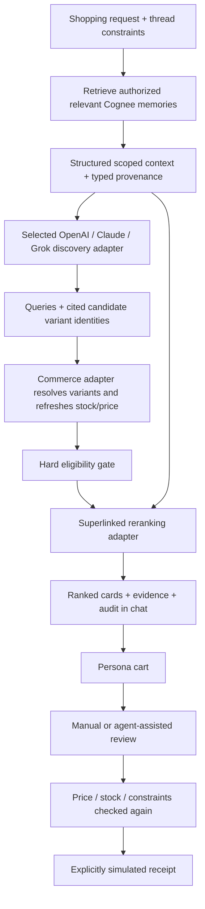

# Known

A runnable personal shopping prototype. **Cognee memory feeds discovery before ranking.** Products appear inside shopping chat threads, with persona-specific results and inspectable evidence.

## Run

Requires Node.js 22+ (no packages to install).

```sh
cd /Users/dayeon/Repository/shopping
cp .env.example .env
npm start
```

Open http://127.0.0.1:4317. From inside this directory, just run `npm start`. Run `npm test` for the pipeline tests; `npm run dev` enables server reloads. The app uses no CDN, external fonts, telemetry, or external images.

Default mode is **demo**. All products, prices, stock, personal memories, provider activity, and ranking scores are fictional and explicitly labeled. There is no payment integration. Manual and agent-assisted checkout both create local simulated receipts after review and a second inventory/price/constraint check.

## Demo walkthrough

1. Maya opens on “Find me a backpack,” with product cards already in chat. Metro Commuter ranks first because of laptop, minimal style, and rain-related memories.
2. Click a rank or match score to inspect memory provenance, matched features, variant verification, and the catalog citation. Open the complete audit for the actual discovery queries and exact scoped context.
3. Switch to Jordan. The same request favors Day Together Organizer because of organization, easy-clean materials, and capacity. Persona state, carts, threads, and receipts remain separate.
4. Adjust budget, rain protection, or jacket size within a thread. Apply runs the full pipeline again. Every submitted message also runs a new retrieval and search. Hard constraints survive follow-ups within that thread.
5. Under Suggested for You, inspect “Why this?” and start a conference-jacket thread. Maya’s presentation/carry-on context favors Studio Travel Blazer; Jordan’s school-visit context favors Field Day Jacket.
6. Open My Context. Search “layers,” inspect a retrieved preference, and add it to Stable preferences. Ownership and Upcoming events stay separate; calendar events cannot be converted to preferences.
7. Add a product to cart, review either checkout path, and explicitly confirm a simulated order. No money is moved.

Demo search supports backpacks and jackets. Natural-language hard constraints support budget phrases (under/below/up to/max/budget), rain protection, and size XS–XXL. The form is the authoritative way to set other thread constraints. This is a finite catalog simulator, not a general language model. Demo source links use example.com and do not represent merchant pages.

## Architecture and implementation plan

Implemented sequence:



- `src/seed.js`: runnable personas, typed memories, fictional variant catalog.
- `src/adapters.js`: interchangeable retrieval, discovery, verification, and reranking adapters.
- `src/pipeline.js`: enforces retrieval before discovery; uses one context object for discovery and reranking; filters uncited candidates and rejects ineligible variants before ranking. It ignores unknown/duplicate ranking IDs.
- `server.js`: local HTTP API, serialized mutations, atomic file persistence, checkout recheck. Successful searches retain per-request structured audits.
- `public/`: responsive chat UI, threads, memory workflow, cart, evidence dialogs, architecture map.
- `test/`: pipeline ordering, context scope, discovery personalization, variant eligibility, thread constraints, invalid output, and honest configuration failures.

Context is data, never system instructions. Gateway implementations must maintain that boundary in model prompts and tools. Demo memory relevance uses tags; demo ranking is transparent feature scoring, **not Superlinked execution**. Authorized unsaved retrieved preferences can inform a request; “Add to preferences” pins them into the stable-preference view while preserving provenance.

Demo score = `clamp(50 + 9 * matching memory feature count + round((1 - price/budget) * 10), 0, 99)`. Repeated features from independent memories add weight. This score is not a probability. Discovery first selects products matching scoped features; thus context changes candidate selection as well as final order.

## Optional live adapter contract

**Native vendor SDK integrations are not bundled.** The live path is a working HTTP adapter boundary for deployment-specific gateways; adding API keys alone will not connect vendor services. Set `COMMERCE_MODE=live`, implement the normalized gateways below, and configure URLs/tokens in `.env`. These URLs are **Known gateway URLs, not native Cognee/OpenAI/Anthropic/xAI/Superlinked endpoints**. Gateways translate between these stable application contracts and the vendor’s supported API and authentication. Missing configuration fails explicitly; there is no fallback to simulated success.

Each gateway accepts `POST` JSON, uses `Authorization: Bearer <gateway token>`, must respond within 25 seconds, and returns JSON. Secrets remain server-side. Redirects are rejected. The same URL can handle several actions. A live request also requires the user to check the scoped context-sharing consent in chat.

### Cognee gateway

Request:

```json
{"action":"retrieve","owner":"maya","query":"Find me a backpack","kind":"backpack","types":["preference","ownership","event"]}
```

Response:

```json
{"memories":[{"id":"m1","owner":"maya","authorized":true,"type":"preference","text":"I need a protected laptop sleeve","tags":["backpack"],"features":["laptop"],"source":"User-approved conversation / source-id","saved":true}]}
```

My Context calls `retrieve` without `kind` for open memory searches. Saving a retrieved preference calls `{"action":"save_preference","owner":"maya","memoryId":"m1","source":"..."}` and expects a successful JSON response. Gateway authorization must authenticate the real principal, enforce their Cognee datasets/ACLs, and preserve provenance. The app additionally filters ownership, authorization, allowed memory types, and shopping relevance. Do not rely on a client-provided persona ID for production authorization.

Cognee’s official [API documentation](https://docs.cognee.ai/api-reference/introduction) describes search and deployment-specific authentication. The gateway must normalize the actual results into the typed records above, rather than passing a prose completion as authorized memory.

### Chosen search-provider gateway

`OPENAI_GATEWAY_URL`, `CLAUDE_GATEWAY_URL`, and `GROK_GATEWAY_URL` are independent adapters. The app calls only the selected one:

```json
{"action":"discover","context":{"requestId":"...","owner":"maya","query":"...","kind":"backpack","constraints":{"budget":150,"rain":false,"size":null},"memories":[{"id":"m1","type":"preference","text":"...","source":"...","features":["laptop"]}]}}
```

Required response:

```json
{"queries":["16 inch laptop commuter backpack under $150"],"candidates":[{"productId":"merchant-product-1","variantId":"merchant-sku-1","citations":[{"url":"https://merchant.example/product/1","title":"Product listing","source":"Merchant catalog"}]}]}
```

The gateway must make the chosen vendor’s real search-agent call, pass this exact context directly into discovery, and provide executed search queries and citations. Configure model/tool choices in the gateway for your vendor account. No synthetic citations, invented products, or credential sharing with the browser. Product pages and personal memories are untrusted data; they must not authorize purchases or tool actions.

### Commerce verification gateway

Receives `{"action":"verify","candidates":[...],"context":{...}}`.

Returns `{"products":[...]}`. Each product must contain `id`, `variantId`, `kind`, `name`, `description`, `price` (finite nonnegative number), `currency` (`USD` in this prototype), `stock`, `size`, `features`, `merchant`, `url`, `verified: true`, and fresh ISO `verifiedAt`. `color` is optional. Product/variant identities must match a cited candidate. Verification must actually resolve that exact merchant SKU and query current price/stock; do not trust model assertions. `rain` feature must reflect merchant evidence. The application rejects unknown variants, stale verification (>5 minutes), unavailable stock, and hard-constraint failures.

### Superlinked gateway

Receives `{"action":"rank","products":[eligible verified products],"context":{the same scoped context}}`.

Returns:

```json
{"ranking":[{"productId":"merchant-product-1","variantId":"merchant-sku-1","score":88,"evidence":[{"memoryId":"m1","source":"...","text":"...","matchedFeatures":["laptop"]}]}]}
```

The gateway must execute your actual Superlinked schema/query and produce evidence tied to the input memory IDs. The app accepts only eligible variant identities and known evidence memory IDs. It does not claim that a gateway is working merely because its environment variables are present.

**Live checkout is deliberately disabled server-side.** A real purchase integration requires merchant checkout, authenticated users, re-verification through the commerce provider, explicit transaction authorization, idempotency, and payment handling. The current reviewed demo paths are complete without those integrations.

## Persistence, deployment, and limits

This is a single-user local development app bound to loopback by default, with two fictional selectable personas, not two authenticated accounts. State persists in ignored `.data/state.json` with atomic writes. `.env` and state are ignored; never commit credentials or personal memories. To reset demo state, stop the app and move `.data/state.json` aside, then restart. Seeds are created on first demo boot. No database or package installation is required.

Do not expose this local server publicly or put real personal data in it without authentication, server-side principal/dataset binding, session-bound consent, durable audit storage, and deployment hardening. No hosted Work MCP registration, native vendor deployment, or real merchant integration is claimed. Run it in Codex’s browser panel as a local app. The adapter boundaries are ready for those integrations.

## Validation

`npm test` covers the critical privacy and architecture boundary: retrieval precedes discovery, the same scoped context reaches both discovery and ranking, unauthorized/cross-persona memories are excluded, and only eligible cited variants reach chat. Browser QA additionally exercises ranking dialogs, memory search/pinning, conference-jacket threads, cart addition, and agent-assisted simulated confirmation.
