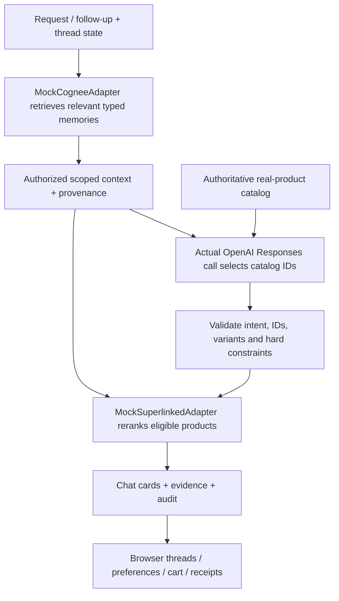

# Known

A personal shopping demo with 24 real products, two personas, shopping threads, natural follow-ups, ranking evidence, and a simulated cart.

## Run locally

Requires Node 22.9+ (Node 22 is configured for Vercel). No dependencies to install.

```sh
cd /Users/dayeon/Repository/shopping
cp .env.example .env
# Add OPENAI_API_KEY to .env for conversational searches.
npm start
```

Open http://127.0.0.1:4317. `npm run dev` restarts the server when files change. `npm test` runs regression tests. `npm run build` creates `dist/` for deployment.

Initial real-product results, budget/attribute filters, persona switching, memory search, preference saving, cart review, and simulated receipts work without keys. Natural conversation uses an **actual OpenAI call** and requires `OPENAI_API_KEY`. Without it, a search displays a connection message; no successful model call is simulated. A jacket suggestion can still open an initial catalog preview without a key.

## Deploy on Vercel

Import `daynkng/shopping`. Repository root is the project root. The checked-in `vercel.json` selects Other, runs `npm run build`, and serves `dist/`. The root `api/search.js` and `api/config.js` are Vercel Functions; do not deploy `public/` alone or rewrite API requests to `index.html`.

Set these server-side variables in Vercel Project Settings → Environment Variables, then redeploy:

```text
OPENAI_API_KEY=<your key>
OPENAI_MODEL=gpt-4.1-mini
```

Use an OpenAI project key with access to the selected model. The model can be changed through `OPENAI_MODEL` to a Responses API model supporting strict structured outputs. The key is never bundled into the client. Claude and Grok are modular, unconfigured adapter extension points. Settings lists only agent connection configuration, not Cognee, Superlinked, or execution mode. “Configured” describes key presence, not a successful test call.

Threads, saved preferences, carts, and receipts persist in this browser’s localStorage (`known-demo-v2`), separated by fictional persona. No server filesystem or shared database is needed. Old `.data/` files from the previous local-only prototype are left untouched and are no longer used. Browser data does not synchronize across devices or deployment origins. Corrupt stored data is reported without being overwritten. The API is stateless and does not retain conversations; OpenAI requests use `store: false`.

For a public demo, configure traffic limits in Vercel and a spend limit on the OpenAI project to bound API costs. No account system or real-person personal-data storage is included.

## What the demo does

- Start from Maya’s backpack results, then switch to Jordan to see a different ranking.
- Every new thread starts without a hidden budget. Budget and relevant attribute filters appear below search results, never in an empty thread.
- Click the whole jacket suggestion to open a separate conference-shopping chat.
- With OpenAI configured, try: “under $150,” “lighter but still fits my 16-inch laptop,” “something more formal,” “only black,” “show alternatives to the first one,” or “remove the budget.” The model receives recent conversation, prior displayed result IDs, existing constraints, and scoped memory before selecting products.
- A clearly different product category changes the shopping category. Ambiguous product references return a clarification. Empty results do not silently relax requirements.
- Rank badges and “Why this ranks” open evidence. “Context & sources” lets users inspect memory provenance and add retrieved preferences. Calendar events remain separate from preferences. Ownership is available internally but has no “What I own” page section.
- Checkout is explicitly simulated. Both manual and agent-assisted review create a local receipt only. No merchant order, payment, live stock check, or real purchase is executed. Real merchant links open product pages.

## Real product catalog

`src/catalog.js` contains exactly 12 backpacks and 12 jackets, captured from the public US merchant catalogs on **November 20, 2026**:

- [Aer](https://aersf.com/products.json?limit=250): six city, tech, work/gym, and travel backpacks.
- [Topo Designs](https://topodesigns.com/products.json?limit=250): six mini, day, commuter, tech, and travel backpacks.
- [Taylor Stitch](https://www.taylorstitch.com/products.json?limit=250): six sportcoats, wool jackets, canvas jackets, and shirt jackets.
- [Outdoor Research](https://www.outdoorresearch.com/products.json?limit=250): six weather shells, insulated jackets, and fleece jackets.

Each record includes a canonical merchant URL, catalog source URL, capture date, original photo URL, local photo, price/currency, variant IDs and snapshot prices, known sizes/colors, and available measurements. Locally bundled photos were retrieved from the corresponding merchants’ public product image URLs; their brands retain ownership. See `CATALOG_SOURCES.md` for the per-product source index.

Aer weights and 16-inch laptop specifications were also checked on the individual merchant pages. Unknown weights, capacities, and laptop dimensions remain null and cannot satisfy hard numeric requirements. Do not infer that a water-resistant product is waterproof. Tailored style, minimalist styling, roominess, organization, and washability tags are editorial classifications grounded in product descriptions/care instructions, identified in each record and ranking details.

**Prices and availability are snapshots, not live verification.** Cards say “Price snapshot.” Variant selection uses matching size/color and snapshot price; variants recorded unavailable are excluded. Source timestamps are never relabeled as current checks. Representative product photos may show a different color than a chosen variant; the merchant page is authoritative. No invented inventory counts are displayed.

## Architecture



`MockCogneeAdapter.retrieve(scope)` and `MockSuperlinkedAdapter.rank(products, context, intent)` are explicit mock connection boundaries, replaceable by real implementations. They do not call either vendor. On **every conversational request**, retrieval completes before the agent call. Discovery and reranking receive the same unchanged context object; the agent’s interpreted constraints and soft preferences are carried separately into eligibility/ranking and recorded in the audit.

Demo context comes from the typed fictional persona seeds. The server reselects authorized memories for that persona rather than trusting arbitrary client-supplied memory text. Saved preference IDs pin existing retrieved preferences and preserve their original provenance. This is not authentication for real users.

The mock ranker scores matching memory features, soft requested attributes, and conference fit. Price and known-weight sorting can override order. Hard filters exclude mismatches before ranking. The model only returns catalog IDs and intent, not trusted prices or inventory. The server resolves product facts from its catalog, rejects invented IDs, and caps visible results to six.

`POST /api/search` receives `owner`, `provider`, `query`, recent `messages`, `kind`, `constraints`, `previousResultIds`, and `savedPreferenceIds`. It returns `reply`, `kind`, full updated `constraints`, ranked `products`, relevant `filters`, and an `audit`. Clarification responses contain a question and no new products. `GET /api/config` returns only agent configuration flags/model name. Unknown providers, malformed data, timeouts, API failures, and non-JSON responses yield clear errors. Mutations and paid model calls are not automatically retried.

Native OpenAI integration uses the [Responses API structured-output format](https://developers.openai.com/api/docs/guides/structured-outputs?api-mode=responses), with catalog ID enums and validation after generation. Instructions keep memory and merchant content as untrusted data, bound the response, and prohibit invented product facts. Keep credentials server-side when adding another provider adapter.

## Validation

Tests cover catalog completeness/photos, sourced variant filtering, persona isolation, null default budget, memory authorization, retrieval-before-discovery, unchanged context at reranking, structured OpenAI payloads, product-reference history, invented ID rejection, clarifications, missing credentials, provider failures, browser persistence, and JSON-response recovery. Mock transport tests do not claim a live OpenAI call. Live end-to-end conversation QA requires the configured key.
