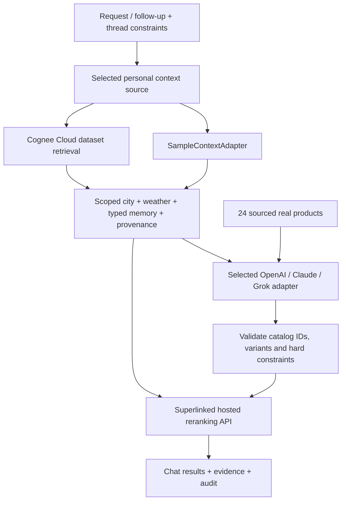

# Known

Two personal shopping demos using real merchant products and live agent/reranking integrations:

- `/demo/maya` — Seattle city commuter and conference presenter.
- `/demo/jordan` — Austin parent and everyday organizer.
- `/` — demo chooser.

Both start with **“Find me a backpack.”** Candidate selection and final ranking come from service calls, not a predetermined result order.

## Start locally

Requires Node 22.9+; no package installation is needed.

```sh
cd /Users/dayeon/Repository/shopping
cp .env.example .env
# Set a selected agent key and SUPERLINKED_API_KEY in .env.
npm start
```

Open http://127.0.0.1:4317. `npm run dev` restarts the local server when files change. `npm test` runs offline regression tests; `npm run build` produces the static client in `dist/`.

## Vercel setup

Import `daynkng/shopping`, using the repository root. `vercel.json` selects Other, runs `npm run build`, serves `dist/`, and routes both demo pages to the app. Root `api/` handlers deploy as Vercel Functions. Do not rewrite `/api/*` to HTML or deploy only `public/`.

Set server-side environment variables in Vercel, then redeploy:

| Integration | Variables | Purpose |
|---|---|---|
| OpenAI | `OPENAI_API_KEY`, `OPENAI_MODEL` | Responses API, structured catalog selection |
| Claude | `ANTHROPIC_API_KEY`, `CLAUDE_MODEL` | Messages API, structured catalog selection |
| Grok | `XAI_API_KEY`, `GROK_MODEL` | Native chat API, structured catalog selection |
| Superlinked | `SUPERLINKED_API_KEY`, `SUPERLINKED_BASE_URL`, `SUPERLINKED_MODEL` | Hosted SIE scoring API; required for personalized results |
| Context | `CONTEXT_SOURCE=sample` or `cognee` | Explicit personal-context source |
| Cognee | `COGNEE_API_KEY`, `COGNEE_BASE_URL`, `COGNEE_MAYA_DATASET_ID`, `COGNEE_JORDAN_DATASET_ID` | Optional Cognee Cloud retrieval and preference saving |

Model defaults are in `.env.example`; choose models actually enabled in your vendor accounts. Superlinked’s default base URL is `https://api.superlinked.com`; the default reranker is `Qwen/Qwen3-Reranker-0.6B`. Use the current hosted model catalog to select another supported scoring model if needed.

Open Settings to select an agent and test all five integrations. “Configured” means credentials are present, not that a call has succeeded. Test connection makes a small real request; a successful result shows its check time. Cognee is optional with sample context and required when `CONTEXT_SOURCE=cognee`. Failed required services stop personalized search. No local ranking or automatic provider substitution is used.

API keys are never returned to the browser or copied into the static build. Configurable service URLs are server environment variables, not client request fields. This is a public demo of fictional personas, not a private-account system. Set project spend and traffic limits appropriate for your deployment before sharing a paid endpoint broadly.

## Detailed demo context

These profiles, memories, events, and weather conditions are fictional demonstration data. Weather is a **dated sample scenario, not a forecast**.

| | Maya | Jordan |
|---|---|---|
| Home | Seattle, Washington | Austin, Texas |
| Routine | Design lead; bikes with a 16-inch laptop | Parent of two; drives between school, work, and family activities |
| Weather scenario | Dec 4, 2026: 46°F / 8°C, rain and cool wind | Dec 8, 2026: 75°F / 24°C, mostly dry with warm afternoons |
| Preferences | Minimal styling, dark colors, protected electronics | Practical compartments, washable materials, family capacity |
| Ownership | Replacing a broken commuter bag; already owns a bulky hiking pack | Small daypack cannot hold snacks, bottles, and family essentials |
| Event | Presentation at Design Forward; carry-on travel | Education Summit with school visits and outdoor breaks |
| Backpack signals | Laptop protection, rain resistance, compact commuting design | Organization, capacity, bottle storage, practicality |
| Jacket signals | Presentation style, weather protection, packability | Lighter layers, washability, indoor/outdoor comfort |

Context produces **soft signals**, not automatic hard requirements. Explicit shopping requests take precedence. No hidden budget is applied. Product characteristics must be supported by the sourced catalog; unknown weights and dimensions stay unknown. Sample dates are scenario dates and do not refresh themselves to appear current.

My Context separates the home profile and situational weather from preference and event memories. Ownership remains available inside the scoped search context. Only a retrieved `preference` record can be added to Preferences; events, weather and ownership cannot be converted. Sample preference choices save to browser storage. In Cognee mode, saving writes through Cognee and reports accepted/indexing state.

## Connect Cognee Cloud

Sample context works without Cognee credentials. To use the real connection:

1. Create a Cognee Cloud key. Copy your **tenant API URL** from its API Keys page into `COGNEE_BASE_URL`; do not use the dashboard URL.
2. Set `COGNEE_API_KEY` and `COGNEE_BASE_URL` in local `.env`.
3. Run `npm run setup:cognee`. The script creates or reuses separate `known-demo-maya` and `known-demo-jordan` datasets, ingests typed records, starts graph indexing, and verifies source-backed retrieval. An optional `COGNEE_DATASET_PREFIX` changes the dataset names.
4. Copy the two returned dataset IDs into Vercel and set `CONTEXT_SOURCE=cognee`. Redeploy and test Cognee for each persona.

The setup script uses stable per-record filenames and identical record bodies, making repeated ingestion safe with Cognee’s identical-content handling. Existing explicit dataset IDs are reused. No dataset deletion is performed. Initial indexing may take longer than the script’s three-minute verification window; re-run after indexing completes.

The adapter calls Cognee’s native CHUNKS search scoped to the server-mapped dataset. Ingested JSON records retain IDs, owner, type, source, capture date, authorization, tags, and typed profile/weather data in a `KNOWN_RECORD:` envelope. The adapter extracts records from returned passage content and rejects untraceable prose, cross-persona records, and missing provenance. Both profile and weather records must be retrievable before that persona can search in Cognee mode. Two personas cannot share one configured dataset ID.

Saving a retrieved preference ingests a stable saved record and requests indexing. “Saved to Cognee; indexing” means ingestion and the indexing request were accepted, not that indexing has completed. There is no sample-data fallback when Cognee is selected and unavailable.

## Search architecture



Discovery and reranking receive the same unchanged context object. Interpreted constraints and preferred features remain separate and are recorded in the audit. Superlinked receives only eligible product documents, plus the scoped location, weather, memories, and user intent in its scoring query. Its raw finite scores determine final order; they are not probabilities or invented numerical feature contributions. Supporting memory/product matches are displayed as separate evidence. No scoring request is needed when there are no eligible products.

Recent conversation and previous displayed IDs let agents resolve “the first one” and preserve constraints through follow-ups. Ambiguous references return a short clarification without fabricated results. Filters appear after results and run the same service-backed pipeline. Failed filter searches restore the preceding constraints.

## Two-demo walkthrough

1. Open the chooser and pick Maya or Jordan. Review the city, routine, and weather scenario, then select **Start demo**.
2. Inspect context and sources on the product results. Switch between the two shareable URLs to compare the same initial request across different contexts.
3. Try “under $150,” “lighter but still fits my 16-inch laptop,” “only black,” “alternatives to the first one,” or “remove the budget.”
4. Start the conference-jacket suggestion. Try “something more formal” for Maya or “lighter and washable” for Jordan.
5. Search My Context, inspect provenance, and add a retrieved preference.
6. Add a product to cart and review either checkout path. Confirmation explicitly creates a **simulated receipt** only.

Reset demo in Settings clears only that persona’s conversation and cart. Preferences and Cognee datasets are preserved. State uses `known-demo-v3` in this browser; each persona is isolated. The previous v2 state is kept for recovery while its cached rankings are invalidated during migration. No cross-device thread synchronization is included.

## Product facts and checkout

The 12 backpacks and 12 jackets are real Aer, Topo Designs, Taylor Stitch, and Outdoor Research products captured on November 20, 2026. Photos are bundled locally, with original photo URLs retained in `src/catalog.js`. See `CATALOG_SOURCES.md` for individual merchant links and source dates.

Prices and availability are **catalog snapshots**. A real agent or ranking connection does not make inventory current. Exact variant selection uses recorded size/color/price evidence; merchant pages confirm final availability and price. Editorial style/organization labels are identified separately from merchant measurements. No live inventory check, merchant order, or payment is executed by checkout. Both manual and agent-assisted confirmation create local simulated receipts only.

## Interfaces and verification

- `GET /api/config`: integration configuration flags and the selected context source; no secrets.
- `POST /api/connection-test`: integration ID and persona; returns actual test outcome and timestamp.
- `POST /api/context`: persona and optional query; returns profile, weather, and authorized typed memories from the selected source.
- `POST /api/preference`: persona and retrieved preference ID; validates type and accepts a pin/write.
- `POST /api/search`: persona, selected provider, query, history, prior result IDs and constraints; returns validated ranked products, concise reply, relevant filters, and audit.

`npm test` uses isolated test transports to verify request contracts, dataset isolation, state migration, hard filters, score validation, and failure handling without paid vendor calls. These tests do not establish live service availability.

With the selected agent and Superlinked credentials configured, run:

```sh
npm run test:live -- --provider=openai
# Or --provider=claude / --provider=grok
```

This explicitly performs connection tests, both initial persona searches, and referenced follow-ups, then checks for a different candidate set or ranking. With `CONTEXT_SOURCE=cognee`, it also verifies both datasets. Missing credentials fail immediately; the app is not reported operational until live checks pass.

Primary API references: [OpenAI structured outputs](https://developers.openai.com/api/docs/guides/structured-outputs), [Claude structured outputs](https://platform.claude.com/docs/en/build-with-claude/structured-outputs), [Grok structured outputs](https://docs.x.ai/developers/model-capabilities/text/structured-outputs), [Cognee API](https://docs.cognee.ai/api-reference/introduction), and [Superlinked scoring](https://superlinked.com/docs/reference/api).
